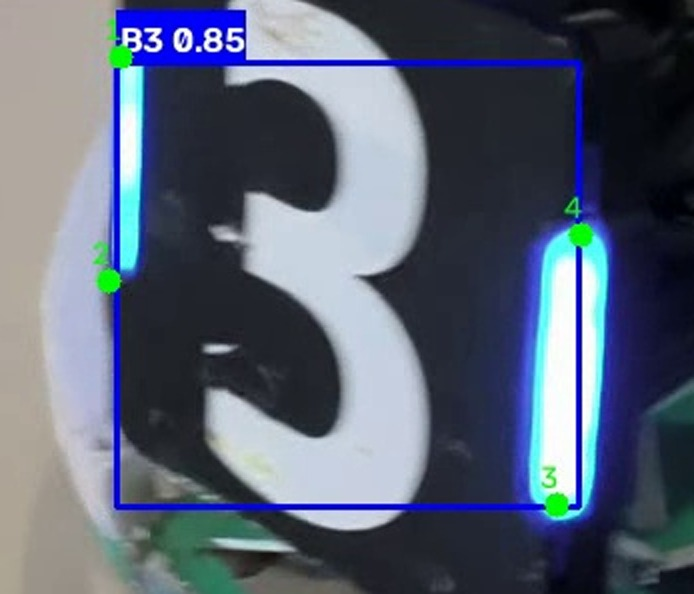

# yolo-armor-inference

**YOLO 装甲板视频推理课程作业**

使用课程统一提供的 **YOLO26n 装甲板四角点模型（best.pt）**，对自己在实验室拍摄的装甲板视频进行推理，并在每个检测目标上绘制 **检测框、类别、置信度** 以及模型预测的 **4 个二维关键点**，最终输出可正常播放的推理结果视频。

---

## 一、项目完成的功能

1. 加载指定的 YOLO26n 装甲板模型权重 `best.pt`；
2. 读取自己拍摄的装甲板视频，逐帧执行目标检测与关键点推理；
3. 在检测到目标时绘制：
   - 检测框（B 系列蓝色、R 系列红色）
   - 类别标签（B1 / B2 / B3 / R1 / R2 / R3）
   - 置信度
   - 模型预测的 **4 个关键点**（绿色圆点 + 序号 1~4），关键点直接取自模型的预测结果，不使用检测框四角代替；
4. 保存与原视频内容对应、可正常播放的推理结果视频；
5. 模型路径、视频路径、输出位置、置信度阈值、推理设备等均通过命令行参数配置，便于复用与调整。

## 二、环境说明

- **Python 版本**：推荐 3.10 ~ 3.12，本项目在 Python 3.13 下亦可运行
- **主要依赖**：
  - `ultralytics>=8.3.0`（加载 YOLO 模型）
  - `opencv-python>=4.9.0`（视频读写与可视化）
  - `numpy>=1.24.0`
  - `torch`（随 ultralytics 自动安装，默认 CPU 版）
- **CPU / GPU**：脚本会自动检测，`torch.cuda.is_available()` 为真时使用 GPU，否则使用 CPU；也可通过 `--device` 手动指定。本作业使用 **CPU** 推理，不要求实时。

## 三、模型权重准备

1. 从课程作业“参考材料”中下载统一提供的模型权重 **`best.pt`**；
2. 将文件放入仓库根目录的 **`weights/`** 文件夹，即路径为 `weights/best.pt`；
3. `weights/` 目录已被 `.gitignore` 排除，**不会**进入 Git 历史，仅作为本地运行所需文件存在。

## 四、运行步骤

```bash
# 1. 克隆仓库并进入目录
git clone <你的仓库地址>
cd yolo-armor-inference

# 2. （推荐）创建并激活虚拟环境
python -m venv .venv
# Windows:
.venv\Scripts\activate

# 3. 安装依赖
pip install -r requirements.txt

# 4. 准备模型与视频
#    - 将 best.pt 放到 weights/
#    - 将自拍视频放到 videos/，例如 videos/armor.mp4

# 5. 运行推理（默认 CPU）
python infer.py --model weights/best.pt --source videos/armor.mp4 \
                --output results/armor_result.mp4 --conf 0.25 --device cpu

# 可选：使用 GPU
python infer.py --model weights/best.pt --source videos/armor.mp4 \
                --output results/armor_result.mp4 --device 0
```

**结果保存位置**：推理结果视频默认输出到 **`results/armor_result.mp4`**（也可通过 `--output` 修改路径）。`results/` 目录同样已被 `.gitignore` 排除，不进入 Git 历史。

主要参数：

| 参数 | 默认值 | 说明 |
| --- | --- | --- |
| `--model` | `weights/best.pt` | 模型权重路径 |
| `--source` | `videos/armor.mp4` | 输入视频路径 |
| `--output` | `results/armor_result.mp4` | 输出视频路径 |
| `--conf` | `0.25` | 置信度阈值 |
| `--iou` | `0.45` | NMS IoU 阈值 |
| `--imgsz` | `640` | 推理输入尺寸 |
| `--device` | 自动 | 推理设备（cpu / GPU 编号） |

## 五、视频拍摄说明

- **拍摄地点**：水建学院 D414 实验室
- **拍摄设备**：手机横屏拍摄
- **拍摄时长**：18.1 秒（1080p，59.07 FPS，共 1072 帧）
- **场景说明**：画面中包含一台绿白配色竞技机器人，机身两侧为黑色面板配白色数字“3”的装甲板（蓝色灯带一侧为 B 类装甲板），拍摄时移动镜头、改变距离与角度，观察模型在不同姿态下的识别表现。
- 视频为本人于 D414 实验室自行拍摄并保留原始文件，未使用网上下载、训练集素材或他人视频。原始文件：`videos/armor_raw.mp4`（本地保存，未提交到 Git）。

## 六、代表性结果截图

下图为本作业推理结果的代表性截图（截取自 `results/armor_result.mp4`，已放大显示）：蓝色检测框标注类别 `B3 0.85`，装甲板上 4 个绿色圆点为模型预测的 4 个二维关键点（编号 1~4）：



## 七、实际识别表现、遇到的问题及处理方法

**识别表现（CPU 推理，conf=0.25，imgsz=640）**
- 全片 1072 帧中 **1058 帧检测到目标**（约 98.7%），检测目标类别为 **B3**（机器人两侧为 B 类装甲板，蓝色灯带侧），置信度主要在 **0.75~0.88** 之间。
- 每个目标均输出 **4 个二维关键点**（来自模型预测，非检测框四角），可视化中绿色圆点按 1~4 编号，可清楚看出关键点属于对应装甲板。
- 推理结果视频 `results/armor_result.mp4`（约 67.5 MB）与原始视频同分辨率（1920×1080）、同帧率（59.07 FPS）、同时长，可正常播放。

**遇到的问题与处理**
1. **少量帧漏检（约 14 帧）**：多发生在机器人转到侧面大角度或画面运动模糊的瞬间，模型对目标姿态与清晰度敏感，属于正常现象；已保留真实结果未做人工修正。
2. **R 系列类别未出现**：视频中机器人未露出红色侧装甲板，因此 R1/R2/R3 在本视频中没有检出目标，并非模型失效。
3. **首次运行时输入了带标注的视频**：作业要求用原始无标注视频做输入，已改用实验室自拍的原片重新推理，避免重复标注。
4. **CPU 推理耗时**：1080p 全片约需 10 余分钟，本作业不要求实时推理，符合预期；如需提速可降低 `--imgsz` 或使用 GPU。
5. **输出编码兼容性**：使用 `mp4v` 编码输出，若个别播放器无法播放，可改用 `avc1` 编码（脚本中已注释说明）。
